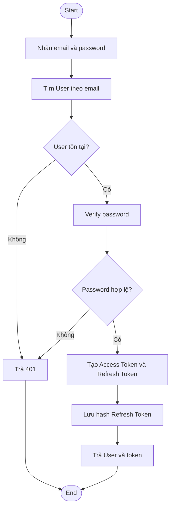
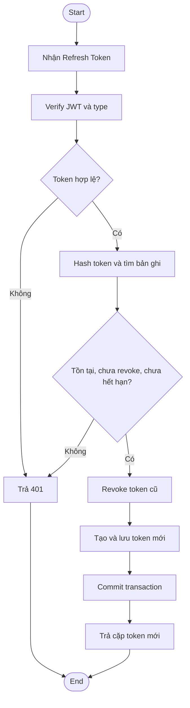

# 01. Authentication Module

## 1. Tổng quan

**Mục tiêu:** Quản lý đăng ký, đăng nhập, xác thực Access Token, làm mới token và đăng xuất.

**Actor:**
- Guest: người chưa đăng nhập.
- User: người dùng đã đăng nhập.
- Admin: người dùng có role `ADMIN`.

**Phạm vi:** Tài liệu này mô tả xác thực và vòng đời token. Quản lý hồ sơ người dùng và thay đổi role thuộc User Management.

## 2. Chức năng (Functional Requirements)

| ID | Chức năng | Mô tả |
|---|---|---|
| AUTH-FR-01 | Đăng ký | Guest đăng ký bằng username, email và password. |
| AUTH-FR-02 | Đăng nhập | Xác thực email/password và cấp Access Token + Refresh Token. |
| AUTH-FR-03 | Xác thực request | Kiểm tra chữ ký, hạn sử dụng và loại Access Token. |
| AUTH-FR-04 | Lấy người dùng hiện tại | Trả thông tin tài khoản từ người dùng đã xác thực. |
| AUTH-FR-05 | Refresh token | Kiểm tra Refresh Token, thu hồi token cũ và cấp cặp token mới. |
| AUTH-FR-06 | Đăng xuất | Thu hồi Refresh Token tương ứng. |
| AUTH-FR-07 | Phân quyền | Từ chối request không có quyền phù hợp. Role hiện tại được đọc từ database. |

## 3. Phi chức năng (Non-functional Requirements)

- Password phải được hash bằng thuật toán phù hợp; không lưu password dạng plaintext.
- JWT phải được ký bằng secret key nằm trong biến môi trường.
- Access Token và Refresh Token phải phân biệt bằng claim `type`.
- Database chỉ lưu hash của Refresh Token, không lưu token thô.
- Token hết hạn, sai chữ ký, sai loại hoặc đã bị thu hồi phải bị từ chối.
- Refresh token rotation phải thực hiện thu hồi token cũ và lưu token mới trong cùng transaction.
- Endpoint cần xác thực phải trả lỗi phù hợp: `401 Unauthorized`; không đủ quyền trả `403 Forbidden`.
- Không ghi password, JWT hoặc refresh token vào log.

## 4. Use Cases

### UC-AUTH-01: Đăng ký

| Thuộc tính | Mô tả |
|---|---|
| Actor | Guest |
| Precondition | Guest chưa có tài khoản với email/username đó. |
| Input | `username`, `email`, `password` |
| Main flow | 1. Guest gửi request. 2. Validate dữ liệu. 3. Kiểm tra email và username đã tồn tại. 4. Hash password. 5. Tạo User với role mặc định `USER`. 6. Trả thông tin User. |
| Alternative flow | Dữ liệu không hợp lệ → `422`; email/username đã tồn tại → `409` (theo quy ước API). |
| Postcondition | Tài khoản được lưu trong database. |

### UC-AUTH-02: Đăng nhập

| Thuộc tính | Mô tả |
|---|---|
| Actor | Guest |
| Precondition | Tài khoản tồn tại và được phép đăng nhập. |
| Input | `email`, `password` |
| Main flow | 1. Guest gửi thông tin đăng nhập. 2. Tìm User theo email. 3. Verify password. 4. Tạo Access Token và Refresh Token. 5. Lưu hash Refresh Token cùng hạn sử dụng. 6. Trả User và token. |
| Alternative flow | Email/password không hợp lệ → `401`. |
| Postcondition | Client nhận được cặp token hợp lệ. |

### UC-AUTH-03: Refresh token

| Thuộc tính | Mô tả |
|---|---|
| Actor | User |
| Precondition | Có Refresh Token hợp lệ. |
| Input | `refresh_token` |
| Main flow | 1. Client gửi Refresh Token. 2. Verify JWT và claim type. 3. Hash token và tìm bản ghi. 4. Kiểm tra chưa thu hồi, chưa hết hạn và đúng User. 5. Thu hồi token cũ. 6. Tạo và lưu token mới. 7. Trả cặp token mới. |
| Alternative flow | Token sai/hết hạn/đã thu hồi → `401`. |
| Postcondition | Token cũ không thể dùng refresh lần nữa; token mới được cấp. |

### UC-AUTH-04: Đăng xuất

| Thuộc tính | Mô tả |
|---|---|
| Actor | User |
| Precondition | Có Refresh Token hợp lệ. |
| Input | `refresh_token` |
| Main flow | 1. Client gửi token. 2. Verify token. 3. Tìm bản ghi token. 4. Thu hồi token. 5. Trả `204 No Content`. |
| Alternative flow | Token không hợp lệ → `401`. |
| Postcondition | Refresh Token không thể sử dụng lại. |

### UC-AUTH-05: Truy cập endpoint cần đăng nhập

| Thuộc tính | Mô tả |
|---|---|
| Actor | User/Admin |
| Precondition | Client gửi Access Token trong Authorization header. |
| Main flow | 1. FastAPI đọc Bearer Token. 2. Verify JWT, hạn dùng và loại token. 3. Lấy User từ database bằng `sub`. 4. Kiểm tra trạng thái/quyền nếu endpoint yêu cầu. 5. Cho phép xử lý endpoint. |
| Alternative flow | Thiếu/sai/hết hạn token → `401`; không đủ quyền → `403`. |
| Postcondition | Request được cho phép hoặc bị từ chối. |

## 5. Activity Diagrams

### Đăng nhập

### Refresh token

## 6. API dự kiến

| Method | Endpoint | Mô tả |
|---|---|---|
| POST | `/api/v1/auth/register` | Đăng ký |
| POST | `/api/v1/auth/login` | Đăng nhập |
| POST | `/api/v1/auth/refresh` | Làm mới token |
| POST | `/api/v1/auth/logout` | Đăng xuất |
| GET | `/api/v1/auth/me` | Lấy User hiện tại |

## 7. Quy tắc nghiệp vụ và lưu ý

- Role mặc định khi đăng ký là `USER`; client không được tự chọn role khi đăng ký.
- `get_current_user` xác thực Access Token và lấy User hiện tại từ database.
- `require_admin` kiểm tra `current_user.role`; không tin role do client gửi lên.
- Đăng xuất thu hồi Refresh Token; Access Token dạng stateless vẫn có thể còn hiệu lực đến khi hết hạn. Nếu cần thu hồi Access Token tức thì, thiết kế denylist/session version ở giai đoạn sau.
- Xử lý race condition khi hai request refresh đồng thời là cải tiến bảo mật cần bổ sung.
