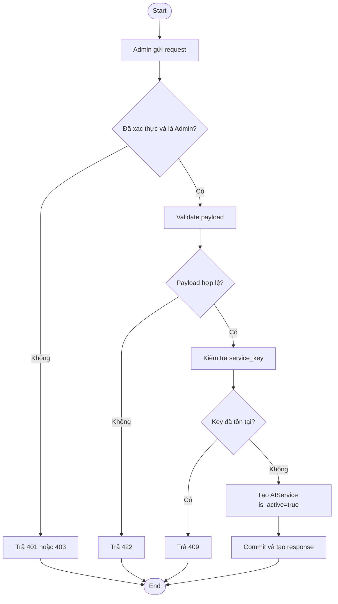
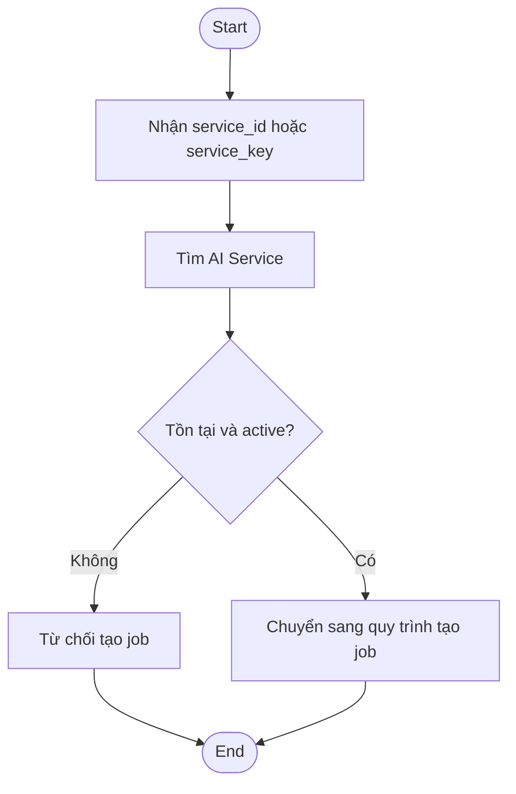

# 02. AI Services Module

## 1. Tổng quan

**Mục tiêu:** Quản lý danh mục các dịch vụ AI mà nền tảng cung cấp, ví dụ Speech-to-Text.

**Actor:**
- Guest: chưa đăng nhập.
- User: xem và sử dụng dịch vụ đang hoạt động.
- Admin: tạo, xem, cập nhật và quản lý trạng thái dịch vụ.

**Phạm vi:** Module quản lý metadata và trạng thái dịch vụ. Module này không trực tiếp chạy mô hình AI; việc thực thi thuộc Inference Worker.

## 2. Chức năng (Functional Requirements)

| ID | Chức năng | Mô tả |
|---|---|---|
| AIS-FR-01 | Liệt kê dịch vụ | User xem danh sách dịch vụ đang hoạt động; Admin có thể xem toàn bộ. |
| AIS-FR-02 | Xem chi tiết | Xem thông tin một dịch vụ theo ID. |
| AIS-FR-03 | Tạo dịch vụ | Admin tạo dịch vụ mới. |
| AIS-FR-04 | Cập nhật dịch vụ | Admin cập nhật tên, mô tả hoặc thông tin được phép thay đổi. |
| AIS-FR-05 | Kích hoạt/vô hiệu hóa | Admin thay đổi `is_active`. |
| AIS-FR-06 | Kiểm tra service key | Đảm bảo `service_key` duy nhất và dùng để định danh dịch vụ. |
| AIS-FR-07 | Kiểm tra khả dụng | Khi tạo job, hệ thống chỉ chấp nhận dịch vụ đang hoạt động. |

## 3. Phi chức năng (Non-functional Requirements)

- `service_key` phải duy nhất, ổn định và không phụ thuộc tên hiển thị.
- Chỉ Admin được tạo/cập nhật/vô hiệu hóa dịch vụ.
- Không trả thông tin bí mật nội bộ hoặc credential của worker trong response.
- Danh sách phải hỗ trợ phân trang.
- Dịch vụ inactive không nhận job mới; job đã tạo trước đó không tự động bị xóa.
- Xóa dịch vụ cần cân nhắc quan hệ với lịch sử job. Khuyến nghị ưu tiên vô hiệu hóa thay vì hard delete.
- Lỗi trùng `service_key` nên trả `409 Conflict`.

## 4. Payload và Response tham khảo

### Tạo dịch vụ — Request

```json
{
  "name": "Speech To Text",
  "service_key": "speech-to-text",
  "description": "Convert audio to text"
}
```

### Tạo dịch vụ — Response

```json
{
  "id": 1,
  "name": "Speech To Text",
  "service_key": "speech-to-text",
  "description": "Convert audio to text",
  "is_active": true
}
```

Client không gửi `id` và không được tự quyết định `is_active` khi tạo. Server gán mặc định `true`.

### Cập nhật — Request

```json
{
  "description": "Transcribe audio into text",
  "is_active": false
}
```

Các trường cập nhật là tùy chọn; chỉ thay đổi trường được gửi lên.

## 5. Use Cases

### UC-AIS-01: Xem danh sách dịch vụ

| Thuộc tính | Mô tả |
|---|---|
| Actor | User; Admin |
| Precondition | Không bắt buộc đăng nhập nếu chính sách sản phẩm cho phép public catalog; nếu không thì yêu cầu User. |
| Input | `page`, `size`, bộ lọc tùy chọn |
| Main flow | 1. Client gửi request. 2. Hệ thống áp dụng quyền xem. 3. Query dịch vụ phù hợp. 4. Trả danh sách và metadata phân trang. |
| Alternative flow | Tham số phân trang không hợp lệ → `422`. |
| Postcondition | Client nhận danh sách dịch vụ. |

### UC-AIS-02: Tạo dịch vụ

| Thuộc tính | Mô tả |
|---|---|
| Actor | Admin |
| Precondition | Admin đã đăng nhập. |
| Input | `name`, `service_key`, `description` |
| Main flow | 1. Admin gửi request. 2. Kiểm tra quyền. 3. Validate dữ liệu. 4. Kiểm tra `service_key` trùng. 5. Tạo bản ghi với `is_active=true`. 6. Trả response. |
| Alternative flow | Không phải Admin → `403`; key trùng → `409`; dữ liệu sai → `422`. |
| Postcondition | Dịch vụ được lưu. |

### UC-AIS-03: Cập nhật dịch vụ

| Thuộc tính | Mô tả |
|---|---|
| Actor | Admin |
| Precondition | Admin đã đăng nhập; dịch vụ tồn tại. |
| Input | `service_id` và các trường cần cập nhật |
| Main flow | 1. Kiểm tra quyền. 2. Tìm dịch vụ. 3. Validate trường được gửi. 4. Cập nhật. 5. Trả response mới. |
| Alternative flow | Không đủ quyền → `403`; không tồn tại → `404`; key trùng → `409`. |
| Postcondition | Dữ liệu dịch vụ được cập nhật. |

### UC-AIS-04: Vô hiệu hóa dịch vụ

| Thuộc tính | Mô tả |
|---|---|
| Actor | Admin |
| Precondition | Dịch vụ tồn tại. |
| Input | `service_id`, `is_active=false` |
| Main flow | 1. Kiểm tra quyền. 2. Tìm dịch vụ. 3. Đặt `is_active=false`. 4. Lưu thay đổi. 5. Trả response. |
| Alternative flow | Không tồn tại → `404`. |
| Postcondition | Dịch vụ không nhận job mới. |

## 6. Activity Diagrams

### Tạo AI Service



### Tạo Inference Job sử dụng dịch vụ



## 7. API dự kiến

| Method | Endpoint | Quyền | Mô tả |
|---|---|---|---|
| GET | `/api/v1/services` | Public/User theo chính sách | Danh sách dịch vụ |
| GET | `/api/v1/services/{service_id}` | User/Admin | Chi tiết dịch vụ |
| POST | `/api/v1/services` | Admin | Tạo dịch vụ |
| PATCH | `/api/v1/services/{service_id}` | Admin | Cập nhật dịch vụ |
| DELETE | `/api/v1/services/{service_id}` | Admin, nếu hỗ trợ | Xóa hoặc vô hiệu hóa |

## 8. Schema dự kiến

- `AIServiceCreate`: `name`, `service_key`, `description`.
- `AIServiceUpdate`: các trường cập nhật tùy chọn.
- `AIServiceResponse`: `id`, `name`, `service_key`, `description`, `is_active`.
- `AIServiceListResponse`: `items`, `total`, `page`, `size`.

## 9. Quyết định thiết kế

- `service_key` là định danh kỹ thuật; `name` là tên hiển thị.
- Dùng `is_active` để ngừng nhận job mà không phá lịch sử.
- `InferenceJob` tham chiếu `AIService` qua `service_id`.
- Không đưa model weights, model path hoặc thông tin máy worker vào response công khai.
