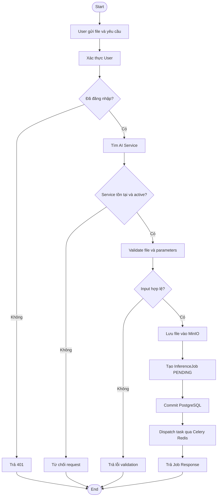
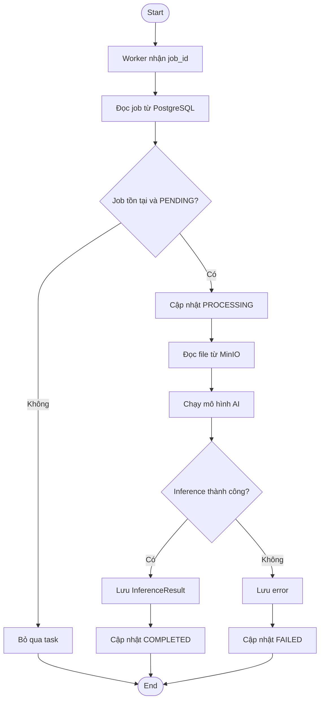

# 03. Inference Jobs Module

## 1. Tổng quan

**Mục tiêu:** Tiếp nhận yêu cầu chạy AI, quản lý trạng thái xử lý, lưu kết quả và cung cấp lịch sử job cho người dùng.

**Actor:**
- User: tạo job và xem các job của chính mình.
- Admin: có thể xem/giám sát job theo chính sách quản trị.
- Celery Worker: nhận task và thực thi inference.

**Kiến trúc xử lý:**
- FastAPI tiếp nhận request và quản lý metadata.
- PostgreSQL là nguồn dữ liệu chuẩn cho trạng thái job.
- Redis làm Celery broker.
- Worker chạy inference (giai đoạn đầu: faster-whisper CPU).
- MinIO lưu file đầu vào và file đầu ra nếu có.

## 2. Chức năng (Functional Requirements)

| ID | Chức năng | Mô tả |
|---|---|---|
| JOB-FR-01 | Tạo job | User gửi file và chọn AI Service đang hoạt động. |
| JOB-FR-02 | Validate input | Kiểm tra loại file, kích thước, service và parameters. |
| JOB-FR-03 | Lưu job | Tạo job với trạng thái ban đầu `PENDING`. |
| JOB-FR-04 | Dispatch task | Đưa job ID vào Celery/Redis để Worker xử lý. |
| JOB-FR-05 | Cập nhật trạng thái | Worker cập nhật `PROCESSING`, `COMPLETED` hoặc `FAILED`. |
| JOB-FR-06 | Lưu kết quả | Lưu output hoặc thông tin lỗi liên quan job. |
| JOB-FR-07 | Xem chi tiết | User xem chi tiết job thuộc sở hữu của mình. |
| JOB-FR-08 | Xem lịch sử | User xem danh sách job của mình có phân trang. |
| JOB-FR-09 | Xem kết quả | User lấy kết quả khi job hoàn tất. |
| JOB-FR-10 | Retry | Cho phép yêu cầu chạy lại job thất bại nếu chính sách cho phép. |

## 3. Phi chức năng (Non-functional Requirements)

- User chỉ được truy cập job thuộc sở hữu của mình, trừ quyền quản trị được định nghĩa rõ.
- Chỉ nhận file và parameters phù hợp với AI Service.
- Không tin `user_id` do client gửi; lấy User ID từ Access Token đã xác thực.
- Tạo job phải lưu bản ghi trước khi dispatch task.
- Worker phải xử lý task theo hướng idempotent để hạn chế xử lý trùng.
- Trạng thái hợp lệ: `PENDING → PROCESSING → COMPLETED/FAILED`.
- Không trả kết quả khi job chưa `COMPLETED`.
- Lỗi xử lý phải được lưu an toàn; không lộ stack trace hoặc thông tin nội bộ cho client.
- Danh sách job cần phân trang và sắp xếp theo thời gian tạo giảm dần.
- Thiết lập giới hạn upload, timeout và giới hạn tài nguyên worker.
- Không giả định Celery enqueue và PostgreSQL commit là một transaction phân tán.

## 4. Trạng thái Job

| Status | Ý nghĩa |
|---|---|
| `PENDING` | Đã tạo, đang chờ worker. |
| `PROCESSING` | Worker đang xử lý. |
| `COMPLETED` | Xử lý thành công, có kết quả. |
| `FAILED` | Xử lý thất bại, có thông tin lỗi phù hợp. |

Luồng trạng thái cơ bản:

```text
PENDING → PROCESSING → COMPLETED
                      ↘ FAILED
```

## 5. Payload và Response tham khảo

### Tạo job

Nếu dùng multipart upload, file được gửi dưới dạng `UploadFile`; `service_id` và `parameters` có thể là form fields. Không nhất thiết phải gửi JSON body thuần.

Ví dụ về dữ liệu logic:

```json
{
  "service_key": "speech-to-text",
  "parameters": {
    "language": "vi",
    "task": "transcribe"
  }
}
```

### Response tạo job

```json
{
  "id": 125,
  "service_id": 1,
  "status": "PENDING",
  "input_file": "users/42/jobs/125/input/audio.wav",
  "created_at": "2026-11-26T10:30:00Z"
}
```

`input_file` nên là object key nội bộ hoặc trường tham chiếu phù hợp; không nên mặc định công khai URL MinIO.

### Response kết quả

```json
{
  "job_id": 125,
  "result": {
    "text": "Xin chào, đây là nội dung được nhận dạng.",
    "language": "vi",
    "duration": 3.5
  },
  "created_at": "2026-11-26T10:30:12Z"
}
```

### Response job thất bại

```json
{
  "job_id": 125,
  "status": "FAILED",
  "error": {
    "code": "INFERENCE_FAILED",
    "message": "Không thể xử lý file đầu vào."
  }
}
```

## 6. Use Cases

### UC-JOB-01: Tạo inference job

| Thuộc tính | Mô tả |
|---|---|
| Actor | User |
| Precondition | User đã đăng nhập; AI Service tồn tại và active. |
| Input | File, service identifier, parameters |
| Main flow | 1. User upload file. 2. Backend xác thực User. 3. Kiểm tra service active. 4. Validate file/parameters. 5. Lưu file vào object storage. 6. Tạo job `PENDING`. 7. Commit database. 8. Dispatch task chứa job ID. 9. Trả job response. |
| Alternative flow | Không đăng nhập → `401`; service không tồn tại/inactive → `404` hoặc `409` theo API policy; file không hợp lệ → `422`; lưu file thất bại → lỗi phù hợp; dispatch thất bại → giữ trạng thái có thể phục hồi và ghi nhận lỗi dispatch. |
| Postcondition | Job được ghi nhận và chờ xử lý hoặc có trạng thái lỗi dispatch có thể được hệ thống phục hồi. |

### UC-JOB-02: Worker xử lý job

| Thuộc tính | Mô tả |
|---|---|
| Actor | Celery Worker |
| Precondition | Job tồn tại và đang `PENDING`. |
| Input | `job_id` |
| Main flow | 1. Worker nhận task. 2. Đọc job từ DB. 3. Kiểm tra job có thể xử lý. 4. Chuyển `PROCESSING`. 5. Đọc input file. 6. Chạy inference. 7. Lưu result. 8. Chuyển `COMPLETED`. |
| Alternative flow | Job không tồn tại/đã xử lý → bỏ qua an toàn; inference lỗi → lưu error và chuyển `FAILED`. |
| Postcondition | Job có trạng thái cuối và kết quả hoặc thông tin lỗi. |

### UC-JOB-03: Xem lịch sử job

| Thuộc tính | Mô tả |
|---|---|
| Actor | User |
| Precondition | User đã đăng nhập. |
| Input | `page`, `size`, bộ lọc status tùy chọn |
| Main flow | 1. Lấy User ID từ Access Token. 2. Query job theo User ID. 3. Áp dụng filter/sort/pagination. 4. Trả danh sách. |
| Alternative flow | Tham số không hợp lệ → `422`. |
| Postcondition | Chỉ trả job thuộc User hiện tại. |

### UC-JOB-04: Xem kết quả

| Thuộc tính | Mô tả |
|---|---|
| Actor | User |
| Precondition | User đã đăng nhập; job thuộc sở hữu của User. |
| Input | `job_id` |
| Main flow | 1. Tìm job theo ID và User ID. 2. Kiểm tra trạng thái. 3. Nếu `COMPLETED`, trả kết quả. |
| Alternative flow | Không tồn tại/không thuộc sở hữu → `404`; chưa hoàn tất → `409` hoặc response trạng thái phù hợp. |
| Postcondition | User nhận kết quả hợp lệ. |

### UC-JOB-05: Retry job

| Thuộc tính | Mô tả |
|---|---|
| Actor | User |
| Precondition | Job thuộc User và đang `FAILED`; retry được bật cho service. |
| Input | `job_id` |
| Main flow | 1. Kiểm tra quyền sở hữu. 2. Kiểm tra trạng thái và giới hạn retry. 3. Tạo lần chạy mới hoặc reset theo chính sách. 4. Dispatch task. 5. Trả thông tin job/lần chạy. |
| Alternative flow | Job không FAILED hoặc vượt giới hạn → `409`; không có quyền → `404`/`403` theo chính sách. |
| Postcondition | Job được lên lịch xử lý lại. |

## 7. Activity Diagrams

### Tạo job



### Worker xử lý



## 8. API dự kiến

| Method | Endpoint | Mô tả |
|---|---|---|
| POST | `/api/v1/jobs` | Tạo job, upload file |
| GET | `/api/v1/jobs` | Lịch sử job của User |
| GET | `/api/v1/jobs/{job_id}` | Chi tiết job |
| GET | `/api/v1/jobs/{job_id}/result` | Kết quả job |
| POST | `/api/v1/jobs/{job_id}/retry` | Retry job nếu được phép |

## 9. Quyết định thiết kế và rủi ro cần xử lý

- `InferenceJob.user_id` lấy từ authenticated user, không lấy từ payload client.
- `InferenceJob.service_id` tham chiếu `AIService`.
- `input_file` lưu object key của MinIO.
- `InferenceResult` gắn với job; nếu cần lưu nhiều lần chạy, nên bổ sung `InferenceAttempt` thay vì ghi đè lịch sử.
- Nếu database commit thành công nhưng enqueue Redis thất bại, job có thể bị kẹt `PENDING`. Bản đầu cần cơ chế retry/reconciliation; hướng bền vững hơn là Transactional Outbox.
- Worker cần kiểm tra trạng thái và cập nhật có điều kiện để giảm nguy cơ xử lý trùng.
- Retry nên được thiết kế rõ: tạo attempt mới là hướng tốt hơn cho khả năng audit.
