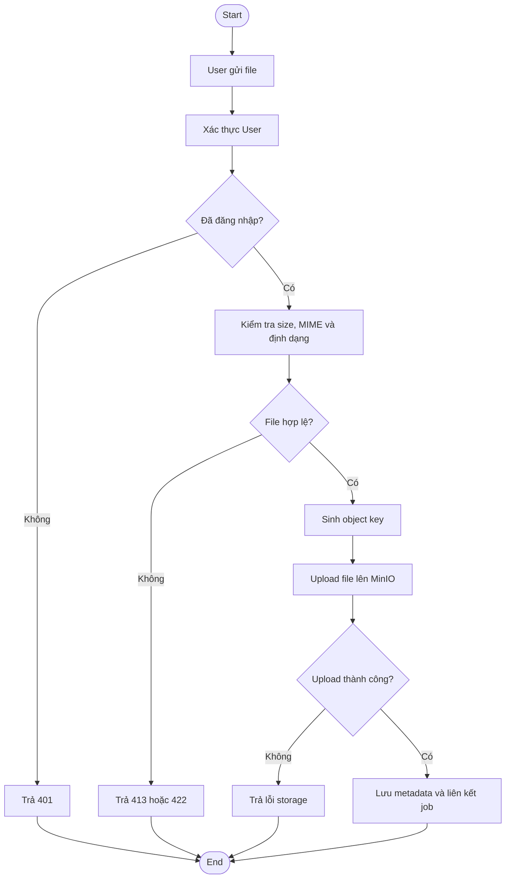

# 04. File Storage Module

## 1. Tổng quan

**Mục tiêu:** Quản lý file đầu vào và đầu ra phục vụ các tác vụ AI. Object storage dự kiến sử dụng MinIO.

**Actor:**
- User: upload file và truy cập file thuộc quyền sở hữu.
- Inference API: yêu cầu lưu/đọc file để tạo và truy xuất job.
- Celery Worker: đọc file đầu vào và ghi file kết quả nếu cần.
- Admin: giám sát dung lượng và chính sách lưu trữ.

## 2. Chức năng (Functional Requirements)

| ID | Chức năng | Mô tả |
|---|---|---|
| FILE-FR-01 | Upload file | Nhận file từ User đã xác thực. |
| FILE-FR-02 | Validate file | Kiểm tra kích thước, phần mở rộng, MIME type và nội dung nếu cần. |
| FILE-FR-03 | Lưu object | Lưu file vào MinIO với object key không đoán được. |
| FILE-FR-04 | Gắn file với job | Lưu object key hoặc metadata liên quan trong database. |
| FILE-FR-05 | Đọc file | API/Worker đọc file theo quyền và mục đích hợp lệ. |
| FILE-FR-06 | Xóa file | Xóa file khi hết hạn hoặc theo yêu cầu/chính sách. |
| FILE-FR-07 | Metadata | Theo dõi tên gốc, kích thước, MIME type, owner, thời điểm tạo và object key nếu cần. |

## 3. Phi chức năng (Non-functional Requirements)

- Bucket MinIO không nên public mặc định.
- Không tin tên file, MIME type hoặc phần mở rộng do client cung cấp.
- Giới hạn dung lượng và loại file theo từng AI Service.
- Object key không nên chứa thông tin nhạy cảm hoặc đường dẫn do client kiểm soát.
- Kiểm tra quyền sở hữu trước khi cho phép download.
- Dùng presigned URL có thời hạn ngắn nếu cần client truy cập trực tiếp.
- Không lưu file lớn dạng binary trong PostgreSQL; DB lưu metadata và object key.
- Có chính sách retention, cleanup file mồ côi và giới hạn dung lượng theo User.
- Không log nội dung file hoặc URL có credential.

## 4. Use Cases

### UC-FILE-01: Upload file để tạo job

| Thuộc tính | Mô tả |
|---|---|
| Actor | User |
| Precondition | User đã đăng nhập; file phù hợp yêu cầu dịch vụ. |
| Input | File upload và thông tin dịch vụ/job |
| Main flow | 1. User gửi file. 2. API xác thực User. 3. Kiểm tra kích thước và định dạng. 4. Sinh object key. 5. Upload lên MinIO. 6. Lưu metadata/object key và liên kết job. 7. Trả thông tin job. |
| Alternative flow | File không hợp lệ → `422`; quá dung lượng → `413`; MinIO lỗi → không tạo job hoàn chỉnh hoặc thực hiện cleanup object đã upload. |
| Postcondition | File được lưu an toàn và liên kết với job. |

### UC-FILE-02: Worker đọc file đầu vào

| Thuộc tính | Mô tả |
|---|---|
| Actor | Celery Worker |
| Precondition | Job hợp lệ và có object key. |
| Input | Object key của file |
| Main flow | 1. Worker nhận job ID. 2. Lấy object key từ DB. 3. Đọc file từ MinIO. 4. Chuyển file cho inference pipeline. |
| Alternative flow | File không tồn tại hoặc không đọc được → job chuyển `FAILED` và lưu lỗi phù hợp. |
| Postcondition | Worker có file để xử lý hoặc job được đánh dấu thất bại. |

### UC-FILE-03: Tải file của mình

| Thuộc tính | Mô tả |
|---|---|
| Actor | User |
| Precondition | User đã đăng nhập; file thuộc sở hữu User. |
| Input | File ID hoặc job ID |
| Main flow | 1. API xác thực User. 2. Kiểm tra quyền sở hữu. 3. Tạo stream hoặc presigned URL ngắn hạn. 4. Trả file/URL. |
| Alternative flow | Không tồn tại hoặc không thuộc sở hữu → `404`; file hết hạn → `410` nếu chính sách dùng mã này. |
| Postcondition | User truy cập được file hợp lệ. |

## 5. Activity Diagrams

### Upload file

## 6. Metadata đề xuất

Tùy mức độ cần quản lý file độc lập, có thể tạo bảng `stored_files`:

| Field | Ý nghĩa |
|---|---|
| `id` | ID nội bộ |
| `user_id` | Chủ sở hữu |
| `object_key` | Đường dẫn object trong MinIO |
| `original_filename` | Tên file gốc |
| `content_type` | MIME type đã kiểm tra |
| `size_bytes` | Kích thước byte |
| `created_at` | Thời điểm upload |
| `expires_at` | Thời điểm hết hạn, nếu có |

Không bắt buộc phải tạo module/bảng file riêng ngay từ đầu nếu file chỉ được dùng nội bộ cho job. Có thể bắt đầu bằng object key trong `InferenceJob.input_file`, rồi mở rộng khi có nhu cầu quản lý file độc lập.

## 7. API dự kiến

Có thể triển khai theo hai hướng:

- Upload gắn trực tiếp với `POST /api/v1/jobs` bằng multipart form.
- Upload riêng: `POST /api/v1/files`, sau đó tạo job bằng `file_id`.

Chọn một hướng ở giai đoạn đầu để tránh tăng độ phức tạp không cần thiết.
