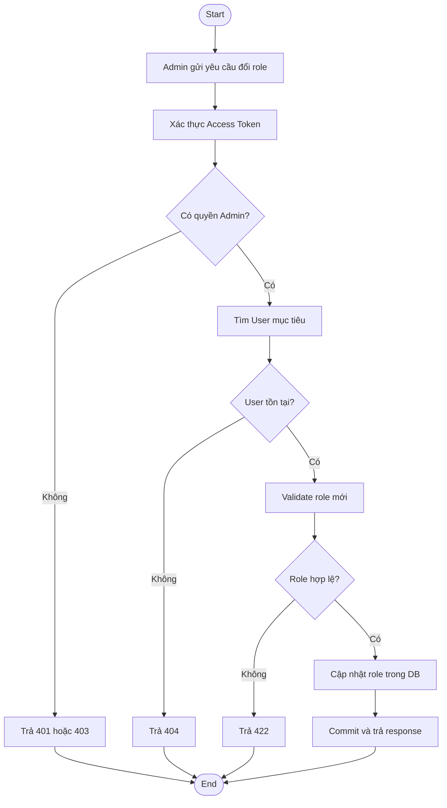

# 05. User Management Module

## 1. Tổng quan

**Mục tiêu:** Quản lý thông tin, trạng thái và quyền của tài khoản người dùng. Module này khác Authentication: Auth xác minh danh tính; User Management quản lý tài khoản sau khi đã có danh tính.

**Actor:**
- User: xem và cập nhật một số thông tin cá nhân của chính mình.
- Admin: xem, quản lý trạng thái và role của tài khoản.
- Guest: không được truy cập các chức năng quản lý tài khoản yêu cầu đăng nhập.

## 2. Chức năng (Functional Requirements)

| ID | Chức năng | Mô tả |
|---|---|---|
| USER-FR-01 | Xem hồ sơ | User xem thông tin tài khoản của mình. |
| USER-FR-02 | Cập nhật hồ sơ | User cập nhật các trường được phép, ví dụ username hiển thị nếu sản phẩm hỗ trợ. |
| USER-FR-03 | Liệt kê User | Admin xem danh sách người dùng có phân trang. |
| USER-FR-04 | Xem chi tiết User | Admin xem thông tin một tài khoản. |
| USER-FR-05 | Thay đổi role | Admin thay đổi role `USER`/`ADMIN` theo chính sách. |
| USER-FR-06 | Khóa/mở khóa tài khoản | Admin thay đổi trạng thái tài khoản nếu hệ thống triển khai trạng thái. |
| USER-FR-07 | Vô hiệu hóa tài khoản | Admin vô hiệu hóa tài khoản theo chính sách thay vì xóa dữ liệu lịch sử. |

## 3. Phi chức năng (Non-functional Requirements)

- User chỉ được cập nhật trường thuộc phạm vi cho phép; không được tự sửa role hoặc trạng thái đặc quyền.
- Chỉ Admin được thay đổi role và trạng thái tài khoản của người khác.
- Không trả `password_hash`, Refresh Token hash hoặc dữ liệu bảo mật trong response.
- Email/username cần tuân thủ unique constraint.
- Danh sách User phải phân trang và có giới hạn `size`.
- Các thao tác nhạy cảm như thay đổi role cần được audit log ở giai đoạn phù hợp.
- Không cho Admin vô tình tự hạ quyền hoặc khóa tài khoản Admin cuối cùng nếu chính sách hệ thống cần bảo vệ trường hợp này.
- Khi khóa tài khoản, cần xác định hành vi với Refresh Token hiện có (khuyến nghị thu hồi token đang hoạt động).

## 4. Use Cases

### UC-USER-01: Xem hồ sơ cá nhân

| Thuộc tính | Mô tả |
|---|---|
| Actor | User |
| Precondition | User đã đăng nhập. |
| Input | Access Token |
| Main flow | 1. API xác thực token. 2. Lấy User từ database. 3. Chuyển thành UserResponse. 4. Trả hồ sơ. |
| Alternative flow | Token không hợp lệ → `401`. |
| Postcondition | User xem được hồ sơ của mình. |

### UC-USER-02: Cập nhật hồ sơ cá nhân

| Thuộc tính | Mô tả |
|---|---|
| Actor | User |
| Precondition | User đã đăng nhập. |
| Input | Các trường hồ sơ được phép cập nhật |
| Main flow | 1. Xác thực User. 2. Validate payload. 3. Kiểm tra unique nếu cập nhật email/username. 4. Cập nhật bản ghi. 5. Trả UserResponse. |
| Alternative flow | Dữ liệu sai → `422`; email/username trùng → `409`. |
| Postcondition | Hồ sơ được cập nhật. |

### UC-USER-03: Thay đổi role

| Thuộc tính | Mô tả |
|---|---|
| Actor | Admin |
| Precondition | Admin đã đăng nhập; User mục tiêu tồn tại. |
| Input | `user_id`, role mới |
| Main flow | 1. Kiểm tra quyền Admin. 2. Tìm User mục tiêu. 3. Kiểm tra quy tắc thay đổi role. 4. Cập nhật role. 5. Ghi audit nếu đã triển khai. 6. Trả response. |
| Alternative flow | Không đủ quyền → `403`; User không tồn tại → `404`; role không hợp lệ → `422`. |
| Postcondition | Role mới có hiệu lực ở request tiếp theo do backend đọc role từ database. |

### UC-USER-04: Khóa tài khoản

| Thuộc tính | Mô tả |
|---|---|
| Actor | Admin |
| Precondition | Admin đã đăng nhập; User mục tiêu tồn tại. |
| Input | `user_id`, trạng thái khóa |
| Main flow | 1. Kiểm tra quyền. 2. Tìm User. 3. Đổi trạng thái. 4. Thu hồi Refresh Token đang hoạt động nếu chính sách yêu cầu. 5. Trả response. |
| Alternative flow | Không đủ quyền → `403`; User không tồn tại → `404`. |
| Postcondition | Tài khoản bị khóa và không thể tiếp tục sử dụng theo chính sách đã định nghĩa. |

## 5. Activity Diagrams

### Thay đổi role

## 6. API dự kiến

| Method | Endpoint | Quyền | Mô tả |
|---|---|---|---|
| GET | `/api/v1/users/me` | User | Hồ sơ của mình |
| PATCH | `/api/v1/users/me` | User | Cập nhật hồ sơ của mình |
| GET | `/api/v1/users` | Admin | Danh sách User |
| GET | `/api/v1/users/{user_id}` | Admin | Chi tiết User |
| PATCH | `/api/v1/users/{user_id}/role` | Admin | Thay đổi role |
| PATCH | `/api/v1/users/{user_id}/status` | Admin | Khóa/mở khóa nếu có status |

## 7. Schema dự kiến

- `UserUpdate`: chỉ chứa trường User được phép tự cập nhật.
- `UserResponse`: `id`, `username`, `email`, `role`, `created_at` và các trường công khai phù hợp.
- `UserListResponse`: `items`, `total`, `page`, `size`.
- `UserRoleUpdate`: role mới.
- `UserStatusUpdate`: trạng thái mới nếu có triển khai.

## 8. Quyết định thiết kế

- Không cho phép client tự gửi `role` trong register hoặc profile update.
- Backend lấy role hiện tại từ database khi phân quyền.
- Không hard delete User nếu còn lịch sử inference job cần giữ.
- Nếu bổ sung `is_active`/`status`, phải định nghĩa rõ tác động đến login, access token và refresh token.
